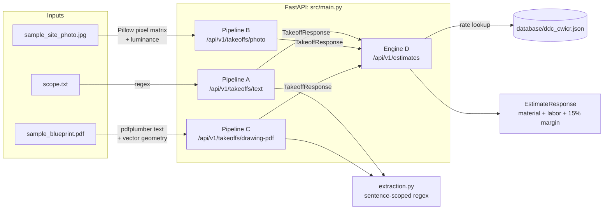

# Blueprint Takeoff Estimator API

A multi-modal FastAPI service that turns construction scope text, jobsite
photos, and drawing PDFs into a unified DDC-CWICR takeoff, and prices that
takeoff into a proposal with material cost, labor cost, and margin.

## Features

- **Three input pipelines** that each produce the same unified takeoff shape:
  - `POST /api/v1/takeoffs/text` — regex-extracts wall/door/flooring
    quantities from a scope-of-work text file.
  - `POST /api/v1/takeoffs/photo` — decodes a real jobsite photo with Pillow,
    computes average luminance to validate the asset, and derives a floor
    area estimate.
  - `POST /api/v1/takeoffs/drawing-pdf` — reads a PDF's text layer with
    `pdfplumber`, taking walls/doors/flooring quantities from unit-aware text
    callouts (`1,500 sq ft` flooring, `120 LF` walls, `4` doors). It also
    reports vector line/curve/rect counts, embedded-image counts and
    warnings (page cap, scanned/image-only pages, unreadable pages) in
    `metadata`. Limits: no OCR for scanned drawings, vector lengths are
    paper-space (no drawing scale applied), and only the first 100 pages are
    scanned (reported when hit). Corrupt or password-protected files return 422.
- **One cost engine**, `POST /api/v1/estimates`, that multiplies any takeoff
  against the local `src/database/ddc_cwicr.json` rate table and applies a
  configurable margin (default 15%).
- Every quantity in every response is derived from real bytes that were
  actually parsed — no synthetic/random placeholder values.

## Architecture



## Getting started

```bash
python -m venv .venv
.venv/Scripts/activate        # Windows; use `source .venv/bin/activate` on macOS/Linux
pip install -r requirements.txt
python bootstrap_assets.py    # downloads real assets into assets/
uvicorn src.main:app --reload --port 8000
```

Interactive API docs are then available at `http://127.0.0.1:8000/docs`.

## cURL quickstart

```bash
# Health check
curl http://127.0.0.1:8000/health

# Pipeline A — text takeoff (uses the bundled assets/scope.txt if no file is attached)
curl -X POST http://127.0.0.1:8000/api/v1/takeoffs/text \
  -F "file=@assets/scope.txt;type=text/plain"

# Pipeline B — photo takeoff
curl -X POST http://127.0.0.1:8000/api/v1/takeoffs/photo \
  -F "file=@assets/sample_site_photo.jpg;type=image/jpeg"

# Pipeline C — drawing PDF takeoff
curl -X POST http://127.0.0.1:8000/api/v1/takeoffs/drawing-pdf \
  -F "file=@assets/sample_blueprint.pdf;type=application/pdf"

# Engine D — price a takeoff into a proposal (15% margin by default)
curl -X POST http://127.0.0.1:8000/api/v1/estimates \
  -H "Content-Type: application/json" \
  -d '{
        "items": [
          {"category": "walls", "quantity": 120},
          {"category": "doors", "quantity": 4},
          {"category": "flooring", "quantity": 1500}
        ]
      }'
```

Example response from `/api/v1/estimates` for the payload above:

```json
{
  "line_items": [
    {"category": "walls", "cwicr_code": "04-2200-0010", "material_cost": 540.0, "labor_cost": 1950.0, "line_subtotal": 2490.0},
    {"category": "doors", "cwicr_code": "08-1100-0045", "material_cost": 1800.0, "labor_cost": 390.0, "line_subtotal": 2190.0},
    {"category": "flooring", "cwicr_code": "09-6500-0022", "material_cost": 4650.0, "labor_cost": 6600.0, "line_subtotal": 11250.0}
  ],
  "subtotal": 15930.0,
  "margin_rate": 0.15,
  "margin_amount": 2389.5,
  "total": 18319.5
}
```

## DDC-CWICR rate database

`src/database/ddc_cwicr.json` holds one row per takeoff category, matching
the DataDrivenConstruction OpenConstructionEstimate schema fields
(`cwicr_code`, `description`, `unit`, `material_cost_per_unit`,
`labor_hours_per_unit`, `labor_rate_per_hour`). Add a category there and it's
immediately usable by both the takeoff pipelines and the estimate engine.

## Testing

```bash
python -m pytest -v
```

The suite uploads the real assets fetched by `bootstrap_assets.py` (not
mocks) through `httpx.AsyncClient` into each endpoint, and asserts on both
the extracted quantities and the estimate math end-to-end.

## Repository layout

```
src/
  main.py, config.py, schemas.py, extraction.py
  database/ddc_cwicr.json, loader.py
  routes/takeoffs.py, estimates.py
tests/
assets/                 real downloaded reference assets
bootstrap_assets.py     fetches the real assets over the network
AGENTS.md               commands + rules for coding agents
.agents/skills/blueprint-parsing/SKILL.md
```
