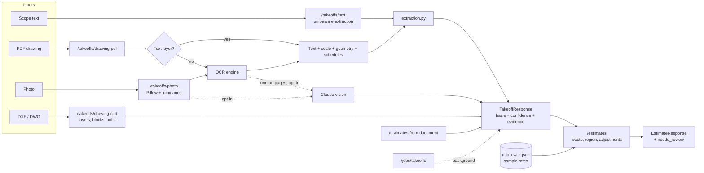

# Blueprint Takeoff Estimator API

**Turn construction documents into an auditable quantity takeoff and a priced estimate.**

Upload scope text, a PDF drawing, a scanned sheet, a jobsite photo, or a DXF/DWG
file. The API reads it, extracts walls, doors and flooring, and prices them. Every
number says **where it came from** (`basis`), **how far to trust it**
(`confidence`) and **the evidence**, and anything that limits a result (a scanned
page it could not read, an unapplied drawing scale, a page cap) is reported
rather than hidden. The goal is a takeoff a person can check, not a black box.

```json
{
  "category": "walls", "unit": "linear_feet", "quantity": 258.29,
  "basis": "cad", "confidence": "high",
  "evidence": "80 double-line wall pair(s) on wall layers"
}
```

## What it reads

| Input | How it is read | Typical trust |
|---|---|---|
| **Scope text** | Unit-aware extraction: `1,500 sq ft`, `120 LF`, `12'-6"`, `3.6 m`, `four doors`. Rejects dimensions (`8-inch`) and part codes (`08-1100-0045`) | high |
| **PDF drawing** | Text layer, door-schedule tables, drawing scale (`1/4" = 1'-0"`, `1:50`), dimension strings, vector geometry (double-line walls, door swings, room areas) | high for text and schedules; medium/low for geometry |
| **Scanned PDF / photo** | OCR (RapidOCR by default, Tesseract optional): deskew, sideways pages, spacing repair | medium; low when OCR confidence is low |
| **DXF** | Layers, named blocks, nested blocks and arrays, units, closed shapes and hatches, room schedules held in block attributes, one floor at a time (`include_blocks`) | high |
| **DWG** | Converted to DXF by an installed converter (see [CAD notes](#cad-notes)) | as DXF |
| **Images inside drawings** | Optional Claude vision, opt-in per request | always low |

Pricing multiplies the takeoff by the rate table and adds waste, a regional
index, overhead, profit, contingency, tax and a margin. It rejects unit mismatches
(for example square feet priced as linear feet) and flags low-confidence lines.

## Status and limits (read this first)

- **The rate table is a 3-row sample.** `src/database/ddc_cwicr.json` follows the
  DDC-CWICR schema but holds only walls (CMU block), doors (hollow metal) and
  flooring (vinyl tile). It is **not** the full DDC-CWICR database. Pricing a
  building with other finishes (concrete, tile, steel doors) with these rates gives
  a wrong number. Add real rates before using an estimate.
- **OCR and vision are never 100%.** OCR accuracy was measured on *synthetic*
  scans only (45/48 clean pages exact; 25/25 under noise, blur, JPEG, skew, low
  contrast, half resolution; about 6 s per page). Real drawings with small, dense
  or stylised text will do worse. Claude vision has only been tested against a
  stand-in client, never live.
- **Geometry is heuristic.** Walls, door swings and room areas inferred from
  vectors need a stated scale and are medium or low confidence.
- **DWG has not been run against a real converter**, only stand-ins. Export DXF
  from your CAD tool when you can.
- **CAD layer meanings depend on your office standard.** The defaults assume
  AIA-style names (`A-WALL`, `A-DOOR`); tune them with `LAYER_RULES_FILE`.
- Not supported: handwriting, IFC/BIM, external references, paper-space sheet
  scales (reported, not applied), MLINE entities.

`needs_review` in every response lists what a person should verify.

## Quickstart

```bash
python -m venv .venv
.venv/Scripts/activate            # macOS/Linux: source .venv/bin/activate
pip install -r requirements-dev.txt
python bootstrap_assets.py        # downloads a sample PDF and photo into assets/
uvicorn src.main:app --reload --port 8000
```

OCR works out of the box (`requirements.txt` installs RapidOCR with its models).
Interactive docs: `http://127.0.0.1:8000/docs`. `GET /health` shows which OCR
engine, vision and DWG converter are available.

```bash
# Scope text, PDF, photo
curl -X POST http://127.0.0.1:8000/api/v1/takeoffs/text        -F "file=@assets/scope.txt"
curl -X POST http://127.0.0.1:8000/api/v1/takeoffs/drawing-pdf -F "file=@assets/sample_blueprint.pdf"
curl -X POST http://127.0.0.1:8000/api/v1/takeoffs/photo       -F "file=@assets/sample_site_photo.jpg"

# DXF: one floor of a multi-floor drawing, walls drawn as double lines
curl -X POST http://127.0.0.1:8000/api/v1/takeoffs/drawing-cad \
  -F "file=@plan.dxf" -F "include_blocks=1F-BLOCK_100" -F "wall_representation=double_line"

# Price a takeoff
curl -X POST http://127.0.0.1:8000/api/v1/estimates -H "Content-Type: application/json" \
  -d '{"items":[{"category":"walls","quantity":120},{"category":"doors","quantity":4},
                {"category":"flooring","quantity":1500}],
       "waste_percent":5,"region_index":1.1,"tax_rate":0.08}'

# Any document -> takeoff + estimate in one call (type detected from content)
curl -X POST http://127.0.0.1:8000/api/v1/estimates/from-document -F "file=@assets/scope.txt"

# Large document in the background, then poll
curl -X POST http://127.0.0.1:8000/api/v1/jobs/takeoffs -F "file=@big.pdf"
curl http://127.0.0.1:8000/api/v1/jobs/<job_id>
```

Add `-F use_vision=true` to a photo or PDF request to opt in to Claude vision
(this sends the image to Anthropic and needs `ANTHROPIC_API_KEY`).

## How it decides

When sources disagree the priority is: door schedule > text callout (text layer,
then OCR) > geometry > vision for PDFs, and CAD geometry > drawing notes for CAD.
A disagreement is a warning and a review reason, never a silent override.
Geometry becomes real-world length or area only with exactly one scale note on
the same page. Several scales, "not to scale" or none means paper-space only and
no geometry items.

## CAD notes

DXF is Autodesk's published format (not open source; it also exists as binary);
ezdxf (MIT) reads both. Beyond layers and blocks, the reader expands nested
blocks and block arrays, skips frozen/off layers, measures splines and ellipses,
and reads room finish schedules held in block attributes (floor areas, de-duplicated
by room id). A drawing that holds several floors, each drawn at several scales,
must be read one top-level block at a time with `include_blocks`; the response
lists `top_level_blocks` so you can choose.

DWG is proprietary. Converters are tried in order: `DWG_CONVERTER_CMD`, the ODA
File Converter (free to download, not open source, restricted redistribution; used
through ezdxf), then LibreDWG's `dwg2dxf` (GPLv3, so it is only ever run as a
separate program, never imported). The converter runs in a child process with a
120 s timeout.

Layer meanings in `examples/layer_rules.jp-apartment.example.json` were inferred
from a real drawing's geometry, not from a published standard. Check
`metadata.layers_present` against your own drawings.

## Configuration

| Variable | Default | Meaning |
|---|---|---|
| `MAX_UPLOAD_MB` | 50 | Larger uploads return 413 |
| `MAX_PDF_PAGES` | 100 | Pages scanned per PDF (hitting the cap is reported) |
| `OCR_MAX_PAGES` / `VISION_MAX_PAGES` | 20 / 5 | Pages OCR'd / sent to vision per request |
| `OCR_ENGINE` | `auto` | `auto` (RapidOCR, else Tesseract), `rapidocr`, `tesseract`, `none` |
| `TESSERACT_CMD` | auto | Tesseract binary, if used (`winget install UB-Mannheim.TesseractOCR`, `apt install tesseract-ocr`) |
| `ANTHROPIC_API_KEY`, `VISION_MODEL` | none, `claude-sonnet-5-5` | Enable vision; images leave the machine only when a request sets `use_vision=true` |
| `DWG_CONVERTER_CMD` | none | e.g. `dwg2dxf -y -o {output} {input}`; wins over auto-detected converters |
| `LAYER_RULES_FILE` | built-in | Your CAD standard's layer/block patterns and optional `rooms` schedule; examples in `examples/` |

## Architecture



## Testing

```bash
python -m pytest -v                 # 213 tests; includes real RapidOCR end to end
python -m pytest -m ocr_engine      # optional: real Tesseract (needs the binary)
python -m scripts.benchmark         # precision/recall over ground-truth cases
```

Tests build PDFs (reportlab) and DXFs (ezdxf) with known dimensions and upload
them as real files. OCR and Claude are replaced by stand-ins only at their own
boundary, so rasterizing, preprocessing, merging, confidence and failure
handling are real. New logic is mutation-checked: change a constant and a test
must fail. The benchmark covers synthetic documents only; add your own labelled
drawings to `scripts/benchmark.py` before trusting real-project accuracy.

## Repository layout

```
src/
  main.py  config.py  schemas.py  findings.py  extraction.py  pipelines.py
  pdf_scan.py  cad.py  jobs.py
  measure/    dimensions.py (12'-6", mm, m)   scale.py (1/4"=1'-0", 1:50)
  geometry/   paths.py  semantics.py (walls, doors, rooms)  schedules.py
  ocr/        engine.py  rapid.py (RapidOCR)  normalize.py  preprocess.py  rasterize.py
  vision/     claude.py
  database/   ddc_cwicr.json  layer_rules.json  loader.py
  routes/     takeoffs.py  estimates.py  jobs.py
examples/     layer-rule files for other CAD standards
tests/  scripts/benchmark.py  assets/  bootstrap_assets.py
AGENTS.md  .agents/skills/blueprint-parsing/SKILL.md
```
