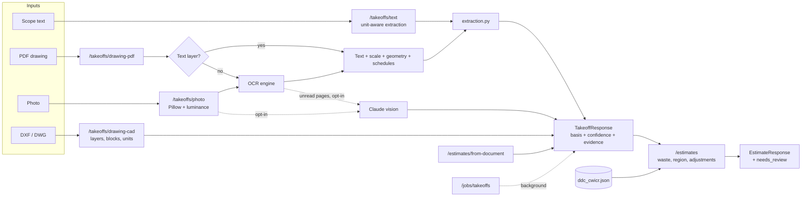

# Blueprint Takeoff Estimator API

A FastAPI service that reads construction documents (scope text, jobsite photos,
PDF drawings, DXF/DWG CAD) into a unified DDC-CWICR takeoff, then prices it
into a proposal. Every takeoff item says **where its number came from**
(`basis`), **how far to trust it** (`confidence`) and **the evidence**, and
anything that limits a result is reported instead of hidden.

## What it can and cannot do

| Capability | Status |
|---|---|
| Text callouts (`1,500 sq ft`, `120 LF`, `12'-6"`, `3.6 m`, `four doors`) | Yes: unit-aware, rejects dimensions and part codes |
| PDF text layer, door schedules (tables) | Yes |
| Drawing scale (`1/4" = 1'-0"`, `1:50`), real-unit lengths | Yes, from an explicit note on the same page |
| Double-line walls, door-swing arcs, room areas from vectors | Yes, heuristic: needs a scale; medium/low confidence |
| Dimension strings found in text | Yes, reported in `metadata.dimensions` |
| DXF drawings: walls, door blocks, floor areas, units | Yes: from layers and blocks (`src/database/layer_rules.json`) |
| DWG | Only through a converter you configure (`DWG_CONVERTER_CMD`) |
| OCR of scanned PDFs / photos | Yes: RapidOCR (pip, no system install) by default, Tesseract optional. Handles skewed and sideways pages |
| Reading drawing *images* (symbols, hand notes, photos) | Optional Claude vision, opt-in per request, always low confidence |
| Pricing | Yes: waste, regional index, overhead/profit/contingency/tax, unit checks |

Honest limits: OCR and vision are never 100%, so `needs_review` flags everything
a person should verify. Geometry heuristics (walls, doors, rooms) are guesses
that need a stated scale. Handwriting, poor scans and non-standard symbols need
human review. Cost accuracy is only as good as the rate table
(`src/database/ddc_cwicr.json` holds three sample categories: add real rates
for others). IFC/BIM is not supported.

## Architecture



## Getting started

```bash
python -m venv .venv
.venv/Scripts/activate            # macOS/Linux: source .venv/bin/activate
pip install -r requirements-dev.txt
python bootstrap_assets.py        # downloads the sample PDF/photo into assets/
uvicorn src.main:app --reload --port 8000
```

OCR works out of the box: `requirements.txt` installs RapidOCR with its models.
Tesseract is optional (`OCR_ENGINE=tesseract`; `winget install
UB-Mannheim.TesseractOCR`, `apt install tesseract-ocr`, `brew install
tesseract`; set `TESSERACT_CMD` if not on `PATH`). `GET /health` shows which
engine is active and whether vision and the DWG converter are available.
Docs: `http://127.0.0.1:8000/docs`.

**Measured OCR accuracy** (synthetic scans of known scope text mixed with
drawing labels; scored by whether the right doors/walls/flooring quantities
come out): 45 of 48 pages exact on clean pages (the 3 misses were text drawn off
the page edge), and 25 of 25 under noise+blur, JPEG-35 with skew, low contrast
and half resolution. Roughly 6 s per full-size page. This is a synthetic test:
real drawings with small, dense or stylised text will do worse. Check
`metadata.ocr.mean_confidence` and `needs_review`.

## cURL quickstart

```bash
curl http://127.0.0.1:8000/health

# Text
curl -X POST http://127.0.0.1:8000/api/v1/takeoffs/text \
  -F "file=@assets/scope.txt;type=text/plain"

# Photo (add -F use_vision=true to opt in to Claude vision)
curl -X POST http://127.0.0.1:8000/api/v1/takeoffs/photo \
  -F "file=@assets/sample_site_photo.jpg;type=image/jpeg"

# PDF drawing (text layer, OCR fallback, scale, geometry, schedules)
curl -X POST http://127.0.0.1:8000/api/v1/takeoffs/drawing-pdf \
  -F "file=@assets/sample_blueprint.pdf;type=application/pdf"

# DXF drawing (units=in|ft|mm|cm|m only needed for unitless files;
# wall_representation=centerline|double_line)
curl -X POST http://127.0.0.1:8000/api/v1/takeoffs/drawing-cad \
  -F "file=@plan.dxf" -F "wall_representation=centerline"

# Price a takeoff (waste_percent, region_index, overhead_rate, profit_rate,
# contingency_rate and tax_rate are optional; margin_rate defaults to 0.15)
curl -X POST http://127.0.0.1:8000/api/v1/estimates \
  -H "Content-Type: application/json" \
  -d '{"items":[{"category":"walls","quantity":120},
                {"category":"doors","quantity":4},
                {"category":"flooring","quantity":1500}]}'

# Any document -> takeoff + estimate in one call (type detected from content)
curl -X POST http://127.0.0.1:8000/api/v1/estimates/from-document \
  -F "file=@assets/scope.txt" -F "region_index=1.1"

# Large document in the background, then poll
curl -X POST http://127.0.0.1:8000/api/v1/jobs/takeoffs -F "file=@big.pdf"
curl http://127.0.0.1:8000/api/v1/jobs/<job_id>
```

Each takeoff item looks like:

```json
{"category": "walls", "cwicr_code": "04-2200-0010", "unit": "linear_feet",
 "quantity": 33.33, "basis": "geometry", "confidence": "medium",
 "evidence": "2 double-line wall segment pair(s) at drawn scale"}
```

`basis` is `text`, `schedule`, `geometry`, `cad` or `vision`. Priority when
sources disagree: door schedule > text callout (text layer, then OCR) >
geometry > vision; CAD geometry > drawing notes. Disagreements are flagged.

## Configuration (environment variables)

| Variable | Default | Meaning |
|---|---|---|
| `MAX_UPLOAD_MB` | 50 | Uploads above this return 413 |
| `MAX_PDF_PAGES` | 100 | Pages scanned per PDF (cap is reported in warnings) |
| `OCR_MAX_PAGES` / `VISION_MAX_PAGES` | 20 / 5 | Pages OCR'd / sent to vision per request |
| `OCR_ENGINE` | `auto` | `auto` (RapidOCR, else Tesseract) / `rapidocr` / `tesseract` / `none` |
| `TESSERACT_CMD` | auto | Tesseract binary path |
| `ANTHROPIC_API_KEY`, `VISION_MODEL` | none, `claude-sonnet-5-5` | Enable vision. Sends the image to Anthropic, only when a request sets `use_vision=true` |
| `DWG_CONVERTER_CMD` | none | e.g. `dwg2dxf -y -o {output} {input}` (run without a shell) |

## Testing

```bash
python -m pytest -v                 # default suite, identical with or without Tesseract
python -m pytest -m ocr_engine      # optional: real-Tesseract test (needs the binary)
python -m scripts.benchmark         # precision/recall over the ground-truth cases
```

Tests build PDFs (reportlab) and DXFs (ezdxf) with known dimensions and upload
them as real files. OCR and Claude are replaced by stand-ins only at their own
boundary, so rasterizing, preprocessing, merging, confidence and failure
handling are real. The benchmark covers synthetic documents only: add your own
labelled drawings to `scripts/benchmark.py` before trusting real-project
accuracy.

## Repository layout

```
src/
  main.py  config.py  schemas.py  findings.py  extraction.py  pipelines.py
  pdf_scan.py   cad.py   jobs.py
  measure/      dimensions.py (12'-6", mm, m)  scale.py (1/4"=1'-0", 1:50)
  geometry/     paths.py  semantics.py (walls, doors, rooms)  schedules.py
  ocr/          engine.py (Tesseract, injectable)  preprocess.py  rasterize.py
  vision/       claude.py
  database/     ddc_cwicr.json  layer_rules.json  loader.py
  routes/       takeoffs.py  estimates.py  jobs.py
tests/  scripts/benchmark.py  assets/  bootstrap_assets.py
AGENTS.md  .agents/skills/blueprint-parsing/SKILL.md
```
